<p align="center">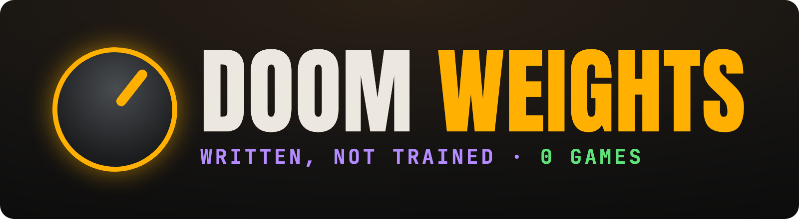</p>

<p align="center">
  
  
  
  
  
</p>

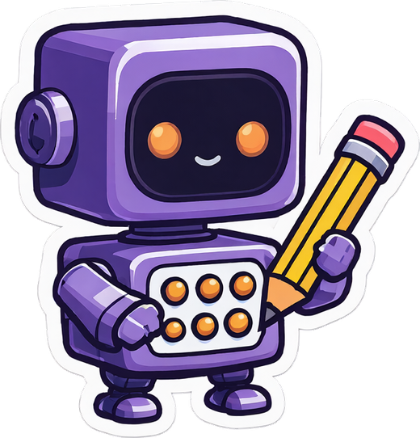

Can an AI **write** a neural network that plays Doom, without ever training it?

**Yes.** Claude wrote every weight of a small network, as a program, and dropped it into real Doom. With **zero games** of practice it matched a network trained the usual way on thousands of games. On the hardest level it scored four times higher with zero games, and seven times higher with fifty.

▶ **The video:** coming soon (Explained by Opus 5.5)

<p align="center">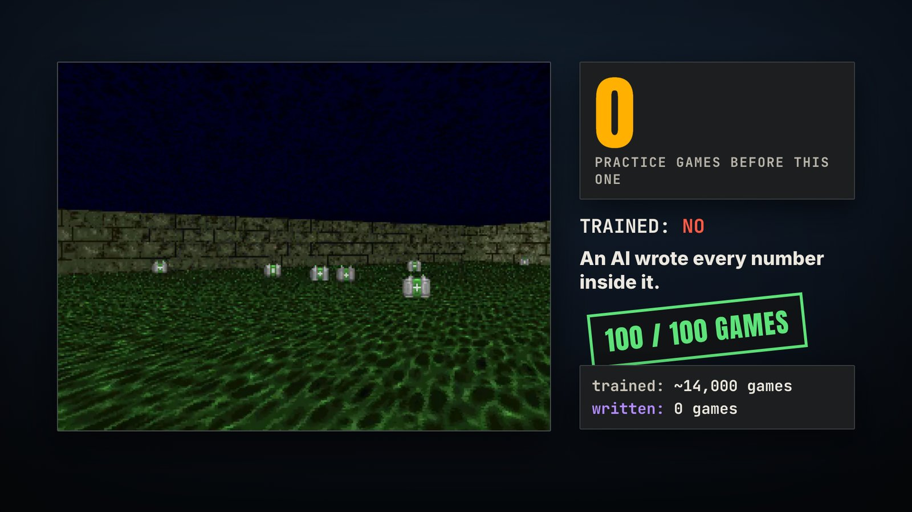</p>

## The trick: fewer games

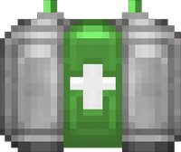

Training learns from scratch and pays for it in experience. PPO, the standard method, needed **thousands to hundreds of thousands of games** per level here. A model writing the network starts from what it already knows and checks it against **zero to fifty games**.

MIT showed the idea in November 2026 with GPT-6 Astra on Breakout ([Sparks of Weight-Space Programming](https://rikiyat.github.io/blog/weight-space-programming/)): every weight starts at zero, the model writes them, no training. This repo asks the same of Claude, on a harder game.

| Level | Written | Trained (PPO, estimated) |
|---|---|---|
| 1 · one monster, map | **0 games** → 80.1 | ~156,000 games → 80.8 |
| 3 · acid floor, raw screen | **15 games** → 2,100 | ~14,000 games → 2,100 (then ~600) |
| 2 · round room, raw screen | **50 games** → 23.1 | ~10,000 games → 15.2 |
| 4 · corridor, map | **50 games** → 1,674 | ~190,000 games in all → 232 |

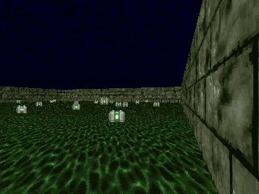

**The acid floor, from memory.** Claude Fable 5.1 never saw this level. It remembered that Doom paints the floor from one ramp of greens where red is about 47% of green (real frames: 48%), wrote a colour test that reads zero on the floor and lights up on a medkit, and survived all 100 scored games. The trained network took about 14,000 games to get there once.

## The board

<p align="center">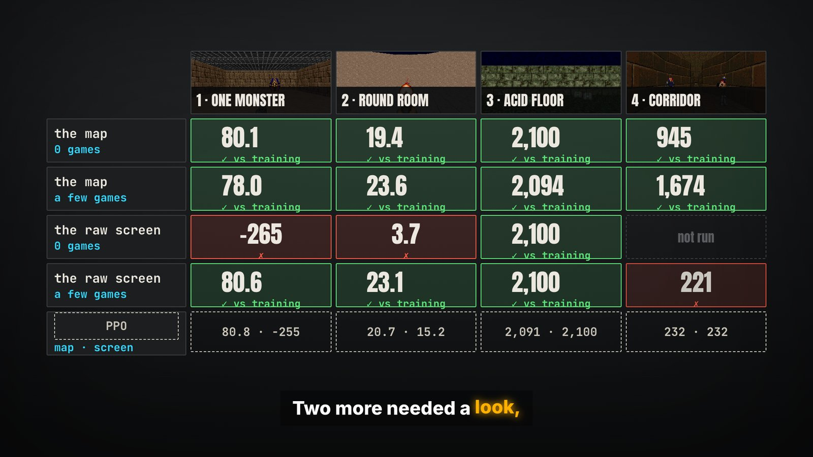</p>

Four levels, two ways to see (a **map** of where things are, or the **raw screen**, only colours), two amounts of practice (**none**, or a few rounds of 5 games). Best written score per cell; higher is better; each level has its own scale.

| Level | Map, 0 games | Map, practice | Raw screen, 0 games | Raw screen, practice | PPO (map · screen) |
|---|---|---|---|---|---|
| 1 · one monster | 80.1 | 78.0 | −265 | 80.6 | 80.8 · −255 |
| 2 · round room | 19.4 | 23.6 | 3.7 | 23.1 | 20.7 · 15.2 |
| 3 · acid floor | 2,100 | 2,094 | 2,100 | 2,100 | 2,091 · 2,100 |
| 4 · corridor | 945 | 1,674 | not run | 221 | 232 · 232 |

## Round 2 was unfair, and that's the lesson

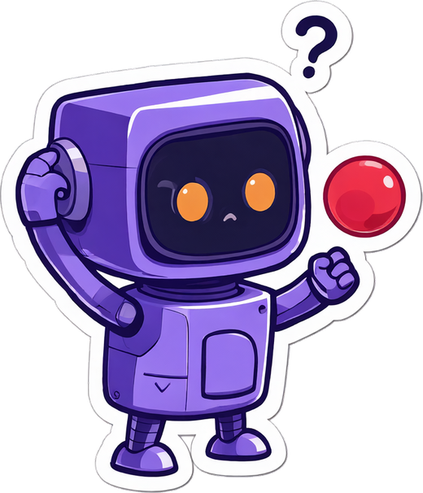
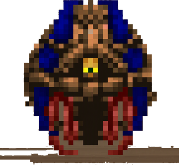

With zero games and only the raw screen, the network has to know what a monster looks like, and nobody had shown it. Our own brief even said "a red, round flying monster". So Opus wrote a detector for a red ball. The real monster (right) is blue with a little red, the detector never fired, and the network shot the walls on every move: **−265**.

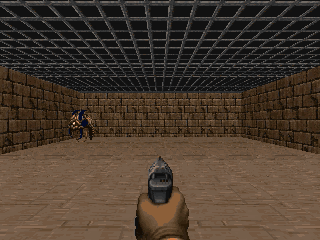

Nobody would build an AI that way. Let it look, and it works: after **one practice round** (5 games), Opus noted that the room is brown and the monster blue and red, rewrote its detector, and scored **76.6**. The trained network had about 18,000 games on that screen and never learned to aim.

## Run it on the next model

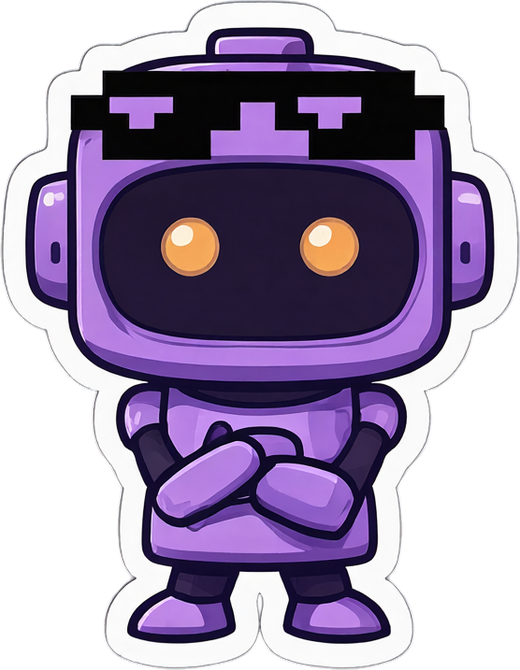

The test is saved: the same levels, the same held-out games, the same rules. When a new model comes out, send it in.

<br clear="right">

```
uv venv -p 3.12 .venv && uv pip install -p .venv/bin/python -r requirements.txt -r requirements-ppo.txt pytest
.venv/bin/python -m pytest -q tests

# a fresh agent writes the weights; we rebuild them, audit the rules and score them
.venv/bin/python -m builder.run_builder --scenario health_gathering --mode pixels --budget 0 --model <model-id>
.venv/bin/python -m builder.run_builder --scenario basic --mode pixels --budget 10 --model <model-id>

# a local model through Pi (it checks the model server answers first)
.venv/bin/python -m builder.run_builder --agent pi --scenario basic --mode objects --budget 0

# a batch, paced against your plan's weekly usage; the trained yardstick; the table
.venv/bin/python -m builder.queue builder/jobs-opus.txt --ceiling 95
.venv/bin/python -m baselines.ppo --scenario basic --mode objects --steps 1000000
.venv/bin/python -m results.summary
```

`claude` must be signed in; each builder run is a full agent session and spends your plan's budget.

**Easier:** open Claude Code in this repo and say *"Read README.md and AGENTS.md, then run the doom-weights test on `<model>` and add it to the board."*

## What's in here

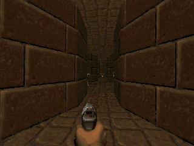

| Path | What |
|---|---|
| `runs/<level>-<view>-b<budget>-<time>/` | Every scored run: the brief it got, its program (`build.py`), its own explanation and score bet, its audit, and every held-out game (`eval.json`) |
| `builder/` | The brief, the launcher, the rule audit and the usage-paced queue |
| `harness/` | The Doom wrapper and exact input encoding, the fixed network, the evaluator, practice rounds |
| `baselines/ppo.py`, `results/` | The trained yardstick, its checkpoint scores, the table, and every bet beside its score |

**In the [release](../../releases):** the weights (one `.npz` per run; each `build.py` also regenerates them exactly), and the raw records: every writer's full session, every practice round's inputs and screens, and the runs that never finished.

**How the rules were kept:** each writer works in a folder outside every repo, with no user instructions or memory, Bash limited to Python and a few read-only commands, no web, and Doom not installed. `builder/audit.py` rebuilds every network from `build.py` and flags fitting, learning libraries, long loops and any look outside the room. Five looks happened across all runs; all five were blocked. Some writers tested ideas in simulators they wrote from memory; never the real game.

## Limits

- One run per setup, a few twice. With no practice, scores swing: Opus scored 16.4 on the round room, then 6.8 on a rerun.
- PPO is a small network on the same inputs, a fair yardstick and not the best Doom AI. Its game counts are estimated from training moves, and its best checkpoint was chosen on the held-out games.
- Thinking costs: an Opus run took 2 to 18 minutes and $0.35 to $5 at API prices, a Fable run 14 to 73 minutes and $5 to $33.

## Credits

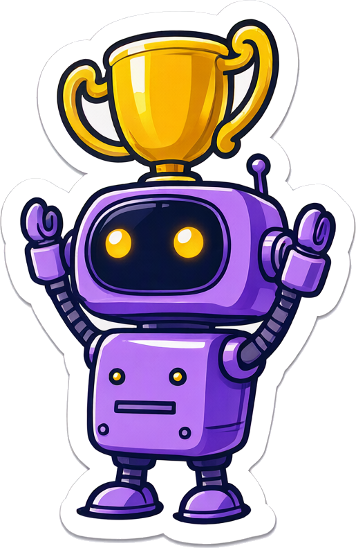

- **Direction:** Lino Valdovinos ([@latent-variable](https://github.com/latent-variable)).
- **The writers:** Claude Opus 5.5 and Claude Fable 5.1. **The harness, runs, video and art:** Claude Opus 5.5, in Claude Code.
- **The idea:** Takehi, Teoh, Zhang and Khattab (MIT CSAIL), *Sparks of Weight-Space Programming*, 2026.
- **Doom:** [ViZDoom](https://github.com/Farama-Foundation/ViZDoom) (MIT) running [Freedoom](https://freedoom.github.io/) (BSD); the monster and medkit cutouts are Freedoom sprites from our own frames. **PPO:** [Stable-Baselines3](https://github.com/DLR-RM/stable-baselines3) (MIT).
- **Robot stickers:** generated with Qwen-Image 2.1. **Fonts:** Anton and JetBrains Mono (SIL OFL).

## License

[MIT](LICENSE) for the code. The run records, results and stickers are released under the same terms; the Freedoom sprites keep Freedoom's BSD licence.
